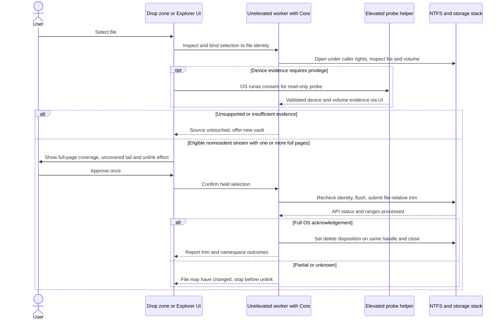
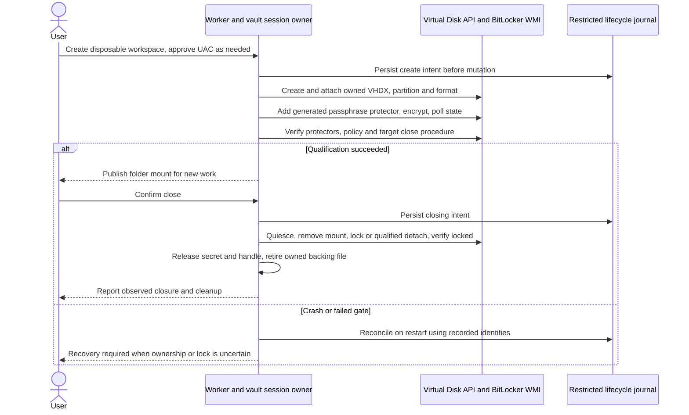

# Context-Aware SSD Shredder · System architecture

Windows 11 has two product paths. File disposal requests deallocation of eligible bytes and then removes the selected directory entry. A vault protects work created inside it after encryption is verified. A declined file operation can recommend a new vault. Creating that vault is a separate user action and leaves the original alone.

## Solution and ownership

```text
SSDShredder.sln
├── src/
│   ├── SSDShredder.Core/             net9.0-windows · file handles, topology, extents, trim
│   ├── SSDShredder.Worker/           net9.0-windows · CLI, IPC, vault owner, recovery
│   ├── SSDShredder.UI/               net9.0 · Avalonia, confirmation, status, picker
│   └── SSDShredder.ShellExtension/   native C++ DLL · IExplorerCommand + identity manifest
├── contracts/                       v1 JSON schemas, examples, exit-code map
├── tests/                           shared fixtures, protocol tests, Windows integration
├── docs/                            research, architecture, build plan, demo
└── CLAUDE.md                        build and review conventions
```

Worker references Core. UI uses the wire contract and a simulator, with Windows launch code behind an OS check. Explorer activates the unelevated UI. macOS can build and exercise the picker, drop-zone, cancellation and mock events. CI builds the native COM project separately on Windows. Windows 11 x64 is the first device qualification target. .NET 9 reached end of support on November 10, 2026. Preserve it for the requested prototype and qualify a supported target before production. [Avalonia platforms](https://docs.avaloniaui.net/docs/supported-platforms) · [.NET lifecycle](https://dotnet.microsoft.com/en-us/platform/support/policy/dotnet-core)

Anchor a small, transparent, borderless, topmost radial surface at the cursor when the user invokes a hotkey or the tray action. Accept ordinary file drops on a visible target. Distinguish the file-disposal and new-workspace actions, allow Escape, and provide a keyboard picker, accessible labels and opaque high-contrast fallback. A global drag detector is optional. The first release handles one local file per operation. On Windows, register a native `IExplorerCommand` via package identity. Use a signed external-location package for the shell and an installer-owned worker in protected Program Files. Register `com:SurrogateServer/com:Class` and `desktop4:FileExplorerContextMenus/desktop5:ItemType` (`Type="*"`), with the same CLSID on `desktop5:Verb`. `GetState` performs cheap selection checks. `Invoke` forwards the selection and returns promptly. Both entry points display the same confirmation. [Explorer registration](https://learn.microsoft.com/en-us/windows/apps/desktop/modernize/integrate-packaged-app-with-file-explorer) · [Window management](https://docs.avaloniaui.net/docs/app-development/window-management)

## Flow A · File disposal



Acquire an ordinary user's mutation-capable file handle with read, write and delete rights and exclusive sharing before the final eligibility check. A selection from a prior read-only inspection must still match the opened file ID and volume. Hold the handle through confirmation. Use handle-based FileIdInfo, FileStandardInfo, FileAttributeTagInfo and FileStreamInfo for identity, link count, type and named streams. Reject UNC, device namespaces and alternate-stream paths. Validate extent coverage, storage topology and page alignment per File 1. Reject hard links, reparse traversal, sparse/compressed/EFS streams, USB/virtual/ambiguous topology, and empty, resident or sub-page files under v1 policy. For an ordinary stream of length N, P is the observed system page size, C = floor(N/P) × P and T = N − C. When C > 0, show C covered bytes and T tail bytes before confirmation. Submit [0,C). An explicitly approved best-effort disposal can unlink after acknowledgement of the entire requested interval. The T bytes have no explicit file-level trim coverage. Revalidate at commit. Elevated helpers never reopen a caller-supplied pathname for file mutation. A failed evidence check preserves the file. The scope of namespace cleanup is the confirmed entry. NTFS retains control over MFT, journals and snapshots. [Microsoft file-level TRIM](https://learn.microsoft.com/en-us/windows/win32/api/winioctl/ni-winioctl-fsctl_file_level_trim)

## Flow B · Vault lifetime and crash recovery



`--vault-init` returns only after a session owner has taken the attach handle and verified readiness. This separate, bounded-lifetime process survives the CLI invocation. The owner holds the transient generated credential, permits one active close and exits after retirement. On a fresh disposable test volume qualify the passphrase-only configuration and close procedure before admitting user data. A recovery-protector requirement can make `Lock(false)` fail. Qualify graceful detach followed by private, read-only/no-letter reattachment, rediscovery by identity and `GetLockStatus` before accepting this alternative. Keep the vault unavailable if both routes fail. A busy volume remains open. Never force-close user handles. Document credential-copy limits and recovery or escrow policy per File 1. [Lock](https://learn.microsoft.com/en-us/windows/win32/secprov/lock-win32-encryptablevolume) · [GetLockStatus](https://learn.microsoft.com/en-us/windows/win32/secprov/getlockstatus-win32-encryptablevolume)

The administrator-protected journal stores the vault ID, owner SID, backing file ID and host volume ID, VHD ID, GPT disk/partition IDs, volume GUID, controlled mount name, phase, opt-in orphan-retirement choice and commit sequence. Store a final lock observation and retirement receipt before dropping the live owner record. A tombstone allows repeated close to return the previous result. Write an atomic, flushed intent before each mutation and record completion afterward. Serialize per vault. An optional installation-time boot task invokes fixed recovery logic over the journal. Preserve objects on ID mismatch, open handles, incomplete identity assignment or uncertain encryption/lock. Recover only recorded, verified, opted-in disposable vaults. A restarted owner cannot reconstruct a lost passphrase. Report orphan state for explicit review if automatic retirement was disabled.

## Commands and wire contract v1

```text
SSDShredder.Worker --inspect <absolute-local-file>
SSDShredder.Worker --shred <absolute-local-file> [--confirm]
SSDShredder.Worker --vault-init
SSDShredder.Worker --vault-status <vault-uuid>
SSDShredder.Worker --vault-close <vault-uuid> [--confirm]
```

For `--shred <path>` or `--vault-close <id>` on an interactive terminal, present the exact target and effects on stderr and require an affirmative response from the console. In noninteractive use both verbs require `--confirm` or exit 2. `--vault-init` creates an empty vault. It accepts no source. Enforce exact arity, reject unknown switches and use OS argument boundaries. Use `--inspect` to preview exact covered and tail byte counts. For `--shred`, `--confirm` acknowledges unlink even with the reported uncovered tail. Direct CLI runs under the user's ordinary token for file disposal. Reject a high-integrity file disposal invocation that cannot establish original ordinary access rights. `--vault-status` queries a recorded vault even if its owner has exited. A repeat close of a positively recorded retired vault returns its existing receipt.

For GUI elevation, precreate a random per-request local pipe with a logon-restricted DACL, first-instance protection and remote clients rejected. Launch only the fixed helper via `ShellExecuteExW(runas)` and retain its process handle. Bind both endpoints to the expected live PID, user, image and session. The elevated pipe client opens with identification-only impersonation quality. Require same-account UAC consent. Different-account credentials fail closed. `PipeOptions.CurrentUserOnly` also checks elevation and cannot implement this mixed-integrity protocol. OS decline 1223 occurs before a worker exists. `runas` cannot supply redirected .NET stdout. The launcher checks the pipe client PID against the retained helper process handle. The helper checks the server PID against its expected parent, trusted installed image, token and logon session. An ordinary CLI invocation may launch the same helper and forward events to stdout. [UAC](https://learn.microsoft.com/en-us/windows/win32/secbp/running-with-administrator-privileges) · [Pipe access](https://learn.microsoft.com/en-us/windows/win32/ipc/named-pipe-security-and-access-rights) · [PipeOptions](https://learn.microsoft.com/en-us/dotnet/api/system.io.pipes.pipeoptions?view=net-9.0) · [Standard output](https://learn.microsoft.com/en-us/dotnet/api/system.diagnostics.processstartinfo.redirectstandardoutput?view=net-9.0)

Use UTF-8 NDJSON, one object per LF, maximum 65,536 UTF-8 bytes excluding LF. Reject invalid UTF-8, oversized frames, wrong types, duplicate keys, unknown fields and repeated request IDs on a connection. All requests carry `v=1`, a new UUID `id`, `op`, `target` and `confirmed`. File verbs take an absolute local path, status/close a vault UUID, init null. Only shred/close accept `confirmed=true` and both require it. A GUI shred also needs a 32-character lowercase hex `selectionToken` returned by eligible inspection. The same ordinary worker accepts inspect followed by one confirmed shred on **the same connection**. Bind the held handle, file ID, volume identity, coverage and token for 60 seconds. Consume the token once. Release on disconnect, timeout or completion. Direct CLI inspection returns no token. CLI shred opens and validates its own handle.

The internal launcher uses `--ipc <32-lowercase-hex-pipe-suffix> --parent-pid <decimal-pid>` with a fixed product prefix. Elevated connections are one-shot. Accept only owned-vault verbs and the private `probe-volume` verb (canonical volume GUID path, confirmed false). Correlate the result to the held file's volume. Probe evidence is `volumeGuid`, `deviceCount`, `bus`, `trimEnabled` and `seekPenalty`. Unknown facts are null. Authorize each vault operation against its recorded owner. A trusted session owner handles subsequent close/status calls through owner-authenticated local IPC, even if the creation launcher has exited.

```jsonl
{"v":1,"id":"ba09878a-81f9-48f4-832a-bef3818e2ddd","op":"shred","target":"C:\\Demo\\fixture.bin","confirmed":true,"selectionToken":"b84d239cd73a26ac9d5f713565040a5f"}
{"v":1,"id":"ba09878a-81f9-48f4-832a-bef3818e2ddd","seq":1,"type":"progress","phase":"trimming"}
{"v":1,"id":"ba09878a-81f9-48f4-832a-bef3818e2ddd","seq":2,"type":"result","code":0,"state":"completed","evidence":{"rangesRequested":1,"rangesProcessed":1,"coveredBytes":4096,"tailBytes":615,"entry":"removed"}}
```

Sequence numbers start at 1 per request. Phases are `inspecting|confirming|trimming|unlinking|creating|encrypting|locking|reconciling`. Emit `trimming` before dispatch. Emit one terminal result when transport permits. The CLI generates a UUID for a command, writes events to stdout and returns its terminal code. Redacted diagnostics go to stderr. Invalid protocol frames with no trustworthy request ID close the connection without executing an operation.

- `0 completed` — includes an inspect operation finding the target ineligible.
- `2 invalid` — arguments/schema. `3 cancelled` — user declined before mutation, including OS 1223 synthesized by the launcher.
- `4 unsupported` — preflight failed. `5 denied` — authority/identity failed. `6 busy` — exclusive access unavailable before mutation.
- `7 failed` — verified pre-mutation failure. `8 indeterminate` — file mutation possible, partial trim, failed unlink, or lost completion after a confirmed request was sent. Leave the name in place when feasible and suppress retries.
- `9 recovery` — an initiated vault transition lacks a verified terminal state. Query the journal. A repeated close of an already retired vault returns its durable receipt under the new request ID.

Inspect evidence contains `eligible`, `reason` (one of `eligible|filesystem|topology|capability|fileType|streams|links|noExtents|noFullPage|unknown`), `bus` (SDK bus name), `coveredBytes`, `tailBytes` and optional `selectionToken`. Coverage means planned file-hint coverage. Shred returns byte counts, nullable `rangesRequested` and `rangesProcessed`, and `entry` (`preserved|removed|unknown`). Report removal only after successful disposition, handle close and verification that the confirmed identity no longer occupies the selected name. Vault results carry `vaultId`, `phase` (`creating|ready|closing|retired|orphan|unknown`), `mount` (path only when ready) and `lockedObserved` (boolean or null). A ready result also includes `conversion` (`fullyEncrypted`), `protectionOn` (true), `protectorTypes` ([8]), `autoUnlock` (false) and `encryptionMethod` (6 or 7 from WMI). Use null for unavailable facts. Pre-approval failure carries the same evidence shape where possible. Never replay a confirmed file operation on transport loss.

```jsonl
{"v":1,"id":"549556c4-3919-4ac7-bba8-e88d46ba6095","op":"vault-close","target":"31f4fcad-b324-4058-a522-da3c7c443523","confirmed":true}
{"v":1,"id":"549556c4-3919-4ac7-bba8-e88d46ba6095","seq":1,"type":"result","code":0,"state":"completed","evidence":{"vaultId":"31f4fcad-b324-4058-a522-da3c7c443523","phase":"retired","mount":null,"lockedObserved":true}}
```
